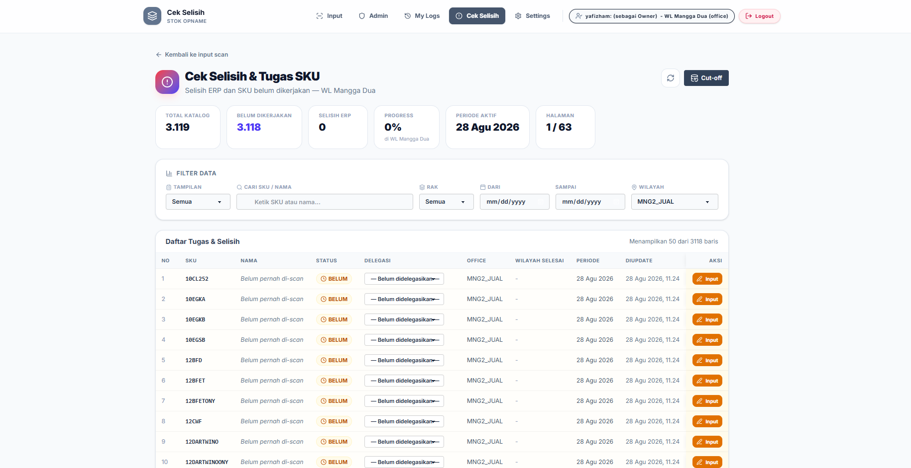
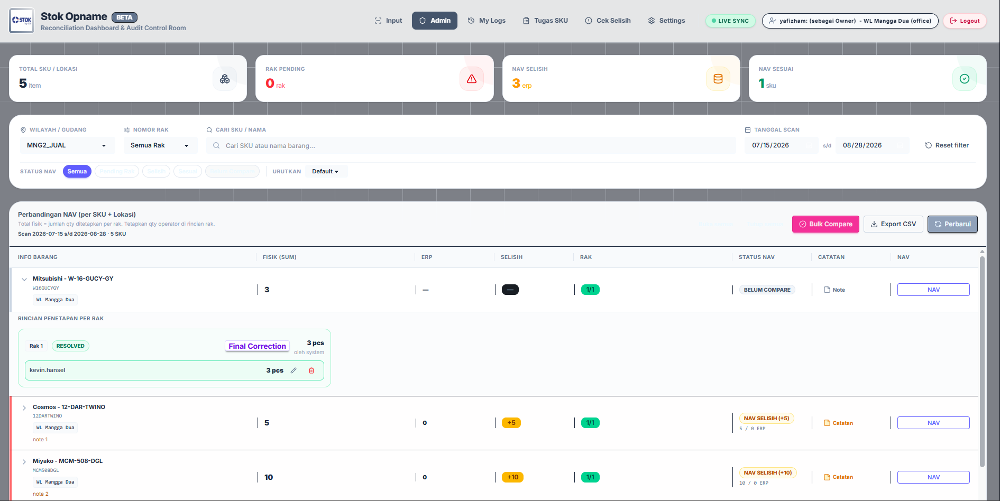
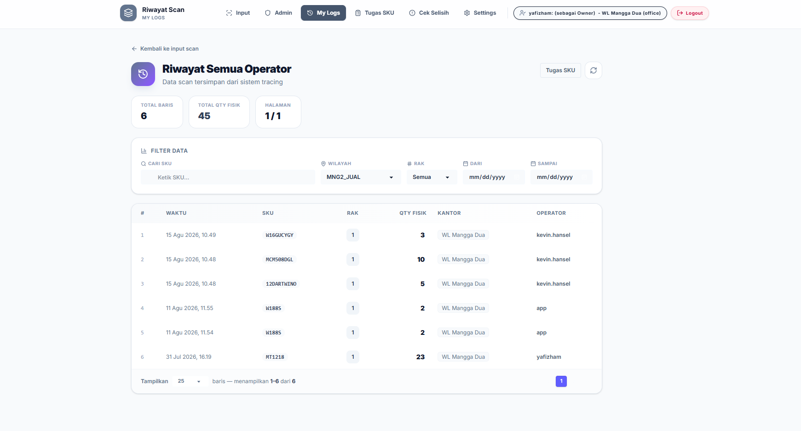
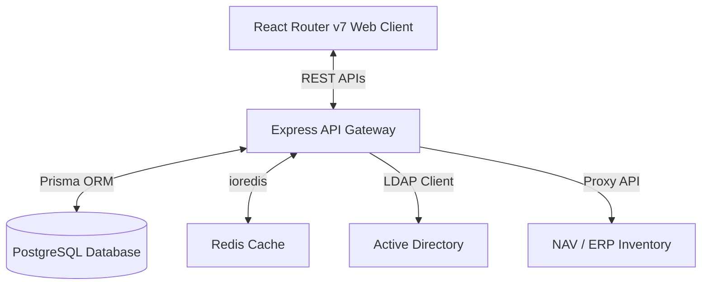
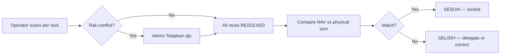

# Inventory Audit System (Stock Opname)

[](https://reactrouter.com/)
[](https://expressjs.com/)
[](https://www.prisma.io/)
[](https://www.postgresql.org/)
[](https://tailwindcss.com/)

A modern, high-concurrency inventory reconciliation and stock audit platform built to automate physical count tracking, compute stock discrepancies, and sync physical warehouse assets with ERP systems (NAV).

---

## 💼 Business Value & Real-World Impact

Discrepancies between system ledger inventory and physical shelf stocks are a primary source of shrinkages, unfulfilled orders, and lost sales. Traditionally, "Stock Opname" is done using paper logs and manual spreadsheets. **Inventory Audit System** solves this by:

* **Digital Scan Logging**: Staff audit warehouse inventory by scanning barcodes and registering counts directly to specific shelves/racks in real-time.
* **Instant Stock Reconciliation**: Automatically calculates matching items and discrepant records (`SESUAI` vs `SELISIH`), highlighting discrepancies immediately.
* **Discrepancy Resolution Workflows**: Allows administrators to delegate specific discrepant items back to operators for verification, or perform direct overriding corrections (`finalCorrectionQty`).
* **Active Directory Integration**: Simplifies large warehouse user access management through Active Directory (LDAP) and local app accounts.

---

## 📸 Screenshots

### Cek Selisih & Tugas SKU — unified task board

Operators and admins track catalog progress, ERP discrepancies, and SKU delegation from a single page. Pending SKUs (`BELUM DIKERJAKAN`) and NAV mismatches (`SELISIH ERP`) appear together with filters, progress stats, and per-row delegation.



### Admin — multi-layer reconciliation dashboard

The admin dashboard runs a two-stage compare: first resolve operator conflicts per rack (`Tetapkan`), then compare physical totals against ERP inventory (`Compare NAV`). Bulk Compare and Export CSV are separate actions.



### My Logs — individual scan history

Every scan adjustment is traced per operator, SKU, rack, and office. Admins can review all operators; field staff see only their own work history.



---

## 🛠️ Tech Stack & Architecture



### Backend
* **Express.js (TypeScript)**: Clean REST APIs compiled using `tsc` and executed via `tsx` / PM2.
* **Prisma ORM**: Relational modeling and database migration management.
* **PostgreSQL**: Transactional storage for audit sessions, scan logs, mapping databases, and audit logs.
* **LDAP JS Client**: Corporate Active Directory login fallback integration.

### Frontend
* **React Router v7**: The next-generation Remix framework implementation, utilizing React 19 and Vite.
* **Tailwind CSS v4**: Ultra-fast utility CSS engine using `@tailwindcss/vite`.
* **React Query & Zustand**: Data synchronization and client state control.
* **DaisyUI**: Premium components styling library.

---

## 📱 Application Pages

| Page | Path | Who can access | Purpose |
|------|------|----------------|---------|
| **Input Stok** | `/input` | Operator, Owner | Search SKU, enter rack + physical qty |
| **Admin** | `/admin` | Admin, Owner | Reconcile scans per rack, compare NAV, bulk export |
| **My Logs** | `/my-logs` | All roles | View scan history (own rows for operators) |
| **Cek Selisih** | `/selisih` | All roles | ERP discrepancies + pending SKU tasks, delegation, cut-off |
| **Settings** | `/settings` | Admin, Owner | User roles, office mapping, app accounts, theme |
| **Docs** | `/docs` | All roles | In-app technical reference for developers |

> **Note:** `/reminder` redirects to `/selisih`. The former "Tugas SKU" page was merged into **Cek Selisih** (Aug 2026).

---

## 👥 Roles & Access Control

Roles are stored locally in the `User` table (not inherited from ERP). Office/warehouse scope comes from ERP `getUserInfo` and is synced on login.

| Role | Input | Admin | Cek Selisih | My Logs | Settings | Office scope |
|------|-------|-------|-------------|---------|----------|--------------|
| **operator** | ✅ | ❌ | ✅ (delegated items only) | ✅ (own scans) | ❌ | Fixed to assigned warehouse |
| **admin** | ❌ | ✅ | ✅ (all items in warehouse) | ✅ (all operators) | ✅ | Pick warehouse or "Semua" |
| **owner** | ✅ (with location) | ✅ | ✅ | ✅ | ✅ | Pick any warehouse |

Login supports **LDAP (Active Directory)** and **local app accounts** (`type: app`). First-time users with `office === "IT"` are auto-assigned the `owner` role.

---

## ⚙️ Core Workflows

### 1. Active Audit Sessions (`OpnameSession`)

All audit activities occur inside a scoped session per warehouse (`office`). When operators scan:

1. The system finds or creates the active `OpnameSession` for that office.
2. Each scan creates or updates a `ScanLog` keyed by **operator + SKU + office + rack** (upsert — qty is *added*, not replaced).
3. A `TracingInput` row is written for every adjustment, powering the My Logs audit trail.
4. Master SKU catalog is sourced from ERP products where **Product Group Code = WL**.

### 2. Multi-Layer Reconciliation Engine

Reconciliation happens in two ordered stages before ERP comparison:



**Stage 1 — Compare scan (per rack):** When multiple operators scan the same SKU/rack, admin approves the authoritative qty via `ScanQtyApproval` (`Tetapkan`). Rows with pending racks cannot proceed to NAV compare.

**Stage 2 — Compare NAV (per SKU + location):** Once all racks are resolved, physical qty (`SUM(approvedQty)`) is compared against ERP inventory. Status values:

| Status | Meaning |
|--------|---------|
| `BELUM_COMPARE` | Physical data exists but ERP check not yet run |
| `SESUAI` | Physical qty matches ERP — **further scans for this SKU are blocked** |
| `SELISIH` | Discrepancy between physical and ERP counts |

Physical quantity formula:
$$\text{Physical Qty} = \sum(\text{ScanQtyApproval.approvedQty}) \quad \text{or} \quad \text{finalCorrectionQty}$$

### 3. Resolution & Delegation Workflow

When discrepancies or unfinished SKUs are found, admins have several resolution paths:

* **Re-audit Delegation** — Assign a specific operator to re-check a `SELISIH` SKU (`CompareItem.delegatedTo`) or a catalog SKU that was never scanned (`SkuReminder.officeDelegations`). Delegated operators only see items assigned to them on Cek Selisih.
* **Final Correction Override** — Admin sets `finalCorrectionQty` (and optionally `finalCorrectionRak`) to establish an authoritative total that bypasses per-rack aggregation. Used when one rack's count should represent the final answer among conflicting resolved values.
* **Notes** — Per-SKU admin notes on `CompareItem.note` are included in CSV exports.

Delegation candidates are limited to **operators in the same warehouse/office**.

### 4. SKU Reminder & Catalog Progress (`SkuReminder`)

The **Cek Selisih** page tracks the full WL product catalog per warehouse period:

* **Total Katalog** — all active WL SKUs from ERP
* **Belum Dikerjakan** — SKUs never scanned in the current period for this office
* **Progress %** — resolved SKUs ÷ total catalog
* **Periode Aktif** — current `startPeriod` / `endPeriod` for the warehouse

**Cut-off** (admin only, per warehouse): starts a new opname period — refreshes the SKU catalog from ERP, resets unresolved tracking for that office, and archives the previous period boundary. Cut-off only affects the selected warehouse; other offices are untouched.

### 5. Scan Input Logic

* **Upsert by operator + SKU + rack + office** — rescanning the same rack adds to the existing qty (with confirmation dialog).
* **Qty 0 is allowed** — useful for marking a rack as empty without deleting history.
* **Self-correction** — operators can submit follow-up scans on the same rack to adjust totals (additive model).
* **SESUAI lock** — once a SKU matches NAV, new scans for that SKU in the same warehouse session are rejected with: *"sku untuk warehouse ini sudah sesuai dengan nav"*.

---

## ⚙️ Local Development Setup

### Backend Setup
1. Navigate to the backend directory:
   ```bash
   cd backend
   ```
2. Copy the environment template:
   ```bash
   cp .env.example .env
   ```
3. Install dependencies:
   ```bash
   pnpm install
   ```
4. Run Prisma migrations and start:
   ```bash
   npx prisma db push
   pnpm run dev
   ```

### Frontend Setup
1. Navigate to the frontend directory:
   ```bash
   cd ../frontend
   ```
2. Copy the environment template:
   ```bash
   cp .env.example .env.local
   ```
3. Install dependencies:
   ```bash
   pnpm install
   ```
4. Run the Vite/React Router development server:
   ```bash
   pnpm run dev
   ```

---

## 📚 Further Documentation

For API endpoints, CSV export columns, and detailed compare logic, see the in-app docs at **`/docs`** after starting the frontend, or read `frontend/app/routes/docs.tsx` in the repository.
